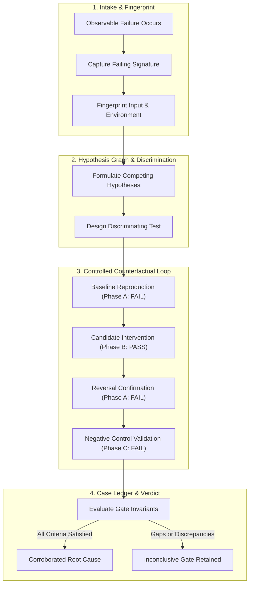

<div align="center">

# Deep Digger

### Catch That Bug
**Evidence-Gated Root Cause Investigation • Controlled Falsification • Delta Minimization • Tamper-Evident Ledgers**

[](LICENSE)
[](https://bun.sh)
[](https://python.org)
[](https://rust-lang.org)
[](https://skills.sh)
[](https://claude.ai)
[](https://github.com/imMamdouhaboammar/deep-digger/actions)

<p align="center">
  <a href="#executive-overview">Overview</a> •
  <a href="#production-value--engineering-outcomes">Value</a> •
  <a href="#feature-matrix">Feature Matrix</a> •
  <a href="#quickstart">Quickstart</a> •
  <a href="#architecture">Architecture</a> •
  <a href="#cli-reference">CLI Reference</a> •
  <a href="#causal-claim-ladder">Claim Ladder</a> •
  <a href="#verification--quality-gates">Verification</a> •
  <a href="#attribution--provenance">Attribution</a>
</p>

</div>

---

## Executive Overview

Difficult software defects invite premature pattern-matching: an AI agent or engineer spots the first plausible stack trace, applies a speculative patch that hides symptoms, and marks the incident resolved, only for the defect to recur under load or in production.

**Deep Digger** (*Catch That Bug*) provides deterministic root-cause investigation for autonomous agents and engineering teams. It maintains competing causal hypotheses, mandates discriminating experiments that actively attempt falsification, preserves failed test runs, and validates root causes through four-phase counterfactual verification ($A \to B \to A \to C$).

---

## Production Value & Engineering Outcomes

### 1. Eliminate Speculative AI Hallucinations
When autonomous coding agents tackle complex regressions, their baseline tendency is symptom-masking (such as increasing timeouts or patching types without addressing state corruption). Deep Digger bounds agent execution behind the four-phase verification contract ($A \to B \to A \to C$). No patch is accepted without reproducible evidence of failure, elimination of failure, reinstatement upon rollback, and resistance to negative controls.

### 2. Algorithmic Input Minimization in Seconds
Rather than spending hours manually bisecting a 50,000-line crash JSON payload or API trace, Deep Digger's zero-dependency minimizer (`--granularity tokens`) executes Zeller's delta debugging algorithm to shrink failing inputs down to the exact atomic tokens causing the fault, providing an instant minimal reproduction fixture.

### 3. Statistical Rejection of Flaky Tests
Non-deterministic defects (race conditions, network jitter, clock skew) frequently produce false-positive green runs. The built-in empirical oracle computes $P(\text{FAIL})$ across repeated executions in isolated environments, preventing tickets or pull requests from closing on accidental passes.

### 4. Autonomous Git Regression Bisection
Pinpoint breaking commits across release boundaries without manual checkouts. Deep Digger coordinates non-interactive `git bisect run` workflows against test oracles, committing culprit commit hashes, authors, and timestamps directly into a tamper-evident evidence ledger.

### 5. Publication-Ready Incident Dossiers
Generate self-contained HTML5 diagnostic reports with a single command (`deep-digger report --html dossier.html`). The resulting document embeds SVG causal DAGs, SHA-256 evidence ledgers, and reproduction scripts with zero external CDN dependencies, fully functional in air-gapped environments.

### 6. Cryptographic Audit Drift Detection
Guarantee that investigated telemetry logs, configuration files, and codebases remain untampered. Deep Digger monitors SHA-256 fingerprints across the investigation lifecycle, immediately failing closed if referenced source files mutate out-of-band.

---

## Engineering Impact Comparison

| Operational Challenge | Without Deep Digger | With Deep Digger |
|---|---|---|
| **Complex Intermittent Bug** | Speculative edits in PRs, guessing from stack traces | Competing causal hypotheses verified via discriminating experiments |
| **Massive Failing Input** | Hours spent manually deleting lines from payloads | Algorithmic token-level reduction to minimal failing syntax in seconds |
| **Flaky Test Suite** | Retrying builds until they happen to turn green | Empirical $P(\text{FAIL})$ calculation with strict non-determinism classification |
| **Multi-Commit Regression** | Manual commit archaeology and git checkout jumping | Non-interactive automated bisect logging culprit metadata to ledger |
| **Post-Mortem Documentation** | Vague retrospective notes without reproducible proofs | Cryptographically signed HTML dossier with embedded causal DAG |

---

## Feature Matrix

| Capability | Traditional Ad-Hoc Debugging | Deep Digger Engine |
|---|---|---|
| **Hypothesis Tracking** | Single unverified hunch | Graph of competing falsifiable hypotheses |
| **Verification Pattern** | Single green test run | Full $A/B/A/C$ counterfactual receipt |
| **Flaky Defect Defense** | Ignored or retried until green | Repetition distribution & strict unresolved gate |
| **Failing Input Shrinking** | Manual trial-and-error | Algorithmic delta debugging (Python & zero-dependency Rust) |
| **Audit & Provenance** | Ephemeral console output | Tamper-evident SHA-256 JSON case ledger (`case.json`) |
| **Authority Boundaries** | Uncontrolled code mutation | Strict isolation: diagnosis separated from mutation |

---

## Quickstart

### 1. Instant CLI Execution

Run Deep Digger directly via Bun or Node without prior installation:

```bash
# Verify system dependencies
bunx deep-digger doctor
# or
npx deep-digger doctor

# Run case initialization
npx deep-digger init cases/incident-01
```

### 2. Universal Agent Skill Installation

Install Deep Digger into your AI agent harness (Claude Code, Antigravity, Gemini CLI, Cursor, Codex, OpenCode):

```bash
# npm / Bun package manager (Global CLI & automatic agent skill registration)
npm install -g deep-digger
# or
bun add -g deep-digger

# Skills.sh registry (Universal AI Agent Skill)
npx skills add imMamdouhaboammar/deep-digger
```

Standard installation targets supported:
- **Claude Code**: Registered in agent skills catalog
- **Antigravity / Gemini CLI**: Registered in agent configuration
- **Universal Agent Kernel**: Registered in multi-agent kernel
- **Project Local**: Registered in project repository

---

## Architecture



---

## CLI Reference

The `deep-digger` CLI coordinates case files, evidence tracking, and delta minimization:

```bash
# 1. Initialize case folder
deep-digger init cases/cache-corruption

# 2. Register competing hypotheses
deep-digger hypothesis cases/cache-corruption add H1 "Cache key collision due to unescaped colon"
deep-digger hypothesis cases/cache-corruption add H2 "Eviction race during concurrent write bursts"

# 3. Attach verifiable evidence artifacts
deep-digger evidence cases/cache-corruption add E1 logs/failing-trace.log supports H1

# 4. Ingest OpenTelemetry, HAR, or JSON traces
deep-digger trace cases/cache-corruption --hypothesis H1 --file traces/otel-span.json

# 5. Link causal relations into a directed acyclic graph (DAG)
deep-digger link cases/cache-corruption --parent H1 --child H2 --relation causes

# 6. Evaluate empirical flakiness and measure P(FAIL)
deep-digger flake cases/cache-corruption --hypothesis H1 \
  --oracle "npm test -- tests/cache.test.ts" \
  --repeats 10 --allow-exec

# 7. Record controlled experiments (requires explicit --allow-exec)
deep-digger experiment cases/cache-corruption add H1 baseline \
  --oracle "npm test -- tests/cache.test.ts" \
  --allow-exec --repeat 2

deep-digger experiment cases/cache-corruption add H1 intervention \
  --oracle "npm test -- tests/cache.test.ts" \
  --allow-exec --repeat 2

# 8. Automated git bisect recorded into evidence ledger
deep-digger bisect cases/cache-corruption --hypothesis H1 \
  --good v1.2.0 --bad v1.3.0 \
  --oracle "npm test -- tests/cache.test.ts" \
  --allow-exec

# 9. Generate isolated test harness reproducer (python, node, bash)
deep-digger repro cases/cache-corruption --template python

# 10. Delta-debug minimal failing payload (lines or tokens)
deep-digger minimize ./payload.json \
  --granularity tokens \
  --output ./minimal.json \
  --allow-exec \
  -- python3 test_oracle.py {input}

# 11. Interactive ANSI terminal dashboard view
deep-digger view cases/cache-corruption

# 12. Generate causal status report (text, json, or standalone HTML dossier)
deep-digger report cases/cache-corruption --format text
deep-digger report cases/cache-corruption --html cases/cache-corruption/dossier.html
```

---

## Causal Claim Ladder

To eliminate speculation, all findings must adhere to the standardized claim ladder:

| Level | Evidence Requirement | Allowed Claim Language |
|---|---|---|
| **Observation** | Concrete error log, trace, or failing event | *"We observed..."* |
| **Reproduction** | Identical signature reproduced on clean baseline | *"The failure reproduces under..."* |
| **Candidate** | Mechanism hypothesized; initial experiments consistent | *"The leading candidate explanation is..."* |
| **Experimentally Corroborated** | Controlled $A/B/A/C$, mechanism verified, alternatives refuted | *"This root cause is corroborated within tested conditions..."* |
| **Inconclusive / Unresolved** | Contradictions, flaky oracle, missing permissions | *"Root cause unconfirmed because..."* |

---

## Verification & Quality Gates

Every release of Deep Digger undergoes multi-tier automated verification:

```bash
# Verify system dependencies
bun bin/cli.js doctor

# Execute Python test suite (22 unit test cases)
python3 -m unittest discover -s evals -p 'test_cli.py' -v

# Execute Rust test suite (12 unit & integration tests)
cargo test --manifest-path rust/Cargo.toml
```

---

## Engineering Solutions

For in-depth architectural patterns and mathematical specifications, see:
- [Evidence-Gated Root Cause Investigation Pattern](docs/solutions/evidence-gated-root-cause-investigation.md)
- [Delta Debugging Invariants & Statistical Oracle Bounds](docs/solutions/delta-debugging-invariants.md)

---

## Attribution & Provenance

- **Author**: [Mamdouh Aboammar](https://github.com/imMamdouhaboammar)
- **Repository**: [https://github.com/imMamdouhaboammar/deep-digger](https://github.com/imMamdouhaboammar/deep-digger)
- **Architecture**: [Omni Skill Architecture](https://github.com/imMamdouhaboammar/omni-skill)
- **License**: MIT
