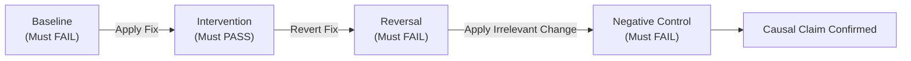

# Evidence-Gated Root Cause Investigation & Controlled Falsification Pattern

## Context & Motivation

When AI coding agents encounter complex, intermittent, or cascading defects in software systems, their default statistical tendency is speculative churn: guessing a plausible culprit, altering code speculatively, and evaluating whether an existing test suite happens to turn green. In asynchronous, distributed, or stateful systems, this causes two critical failure modes:
1. **False Root Cause Attribution**: A superficial symptom or downstream timeout is addressed (e.g. by bumping a timeout threshold), masking the true upstream causal mechanism.
2. **Context Degradation & Hallucination**: Juggling multiple speculative hypotheses without physical experimental receipts degrades the agent's context window, causing compounding logical inconsistencies.

The **Deep Digger** pattern enforces disciplined, evidence-gated investigation and counterfactual verification before any code edit is permitted.

---

## The 4-Phase Causal Quadruplet

To verify that an intervention addresses the actual root cause rather than a coincidental symptom, four distinct experimental phases must be satisfied deterministically:

| Phase | Oracle Requirement | Purpose |
|---|---|---|
| **1. Baseline** | $P(\text{FAIL}) = 1.0$ (min 2 consecutive runs) | Establishes reproducible defect under controlled conditions |
| **2. Intervention** | $P(\text{PASS}) = 1.0$ (min 2 consecutive runs) | Verifies the proposed mechanism eliminates the failure |
| **3. Reversal** | $P(\text{FAIL}) = 1.0$ (min 1 run) | Reverting the fix reinstates the exact original failure |
| **4. Negative Control** | $P(\text{FAIL}) = 1.0$ (min 1 run) | Irrelevant perturbations (whitespace, unrelated configs) fail to cure defect |



---

## J-Space Cognitive Bounds

In autonomous agent architectures, working memory operates under tight capacity limits. Deep Digger mandates the following cognitive invariants:

- **Hypothesis Limit**: No agent may actively track more than **two** competing hypotheses simultaneously. Hypotheses beyond two must either be falsified and archived or placed on a frozen queue.
- **Evidence Calibration**: Every factual assertion must be tagged with an explicit confidence level:
  - `[OBSERVED]`: Directly confirmed from captured logs, telemetry, or disk artifacts.
  - `[REPRODUCED]`: Deterministically executed and captured via isolated harness.
  - `[CANDIDATE]`: Plausible deduction pending discriminating experiment.
  - `[CORROBORATED]`: Supported by independent source (trace + code inspect).
  - `[INCONCLUSIVE]`: Disputed by conflicting observations; blocked from causal ladder.

---

## Tamper-Evident Ledger Integrity

All telemetry traces, HAR logs, and source files captured during investigation are hashed via SHA-256 and committed to a local JSON ledger (`case.json`). 

Before any final diagnostic assertion or pull request generation:
```bash
deep-digger audit <case-folder>
```
The audit scanner re-hashes all referenced source files on disk. If any file has mutated out-of-band, the audit fails closed with an `evidence drift detected` invariant error, preventing conclusions derived from stale state.
