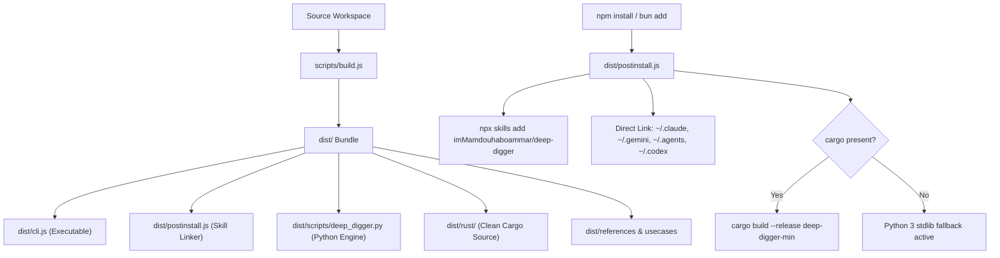

# npm Dist Packaging & Multi-Agent Skill Distribution

> **Compound Engineering Solution & Pattern**

## Overview

Distributing an AI agent skill containing a TypeScript/JavaScript CLI wrapper, a native standard-library Python engine, and high-performance Rust source requires a strict separation of concerns between developer workspace tooling and published production artifacts.

---

## Architectural Pattern

---

## Key Invariants

1. **Physical Artifact Isolation (`dist/`):**
   `package.json` specifies `"main": "dist/cli.js"`, `"bin": { "deep-digger": "dist/cli.js" }`, and `"files": ["dist", "SKILL.md", "marketplace.json", ".skills.json", "LICENSE", "README.md"]`. The repository's `evals/`, test fixtures, `.github/`, and local caches are never distributed to consumers.

2. **Automated Multi-Agent Skill Registration:**
   The `postinstall` script runs automatically on install, attempting `npx skills add` and falling back to direct offline linking into all active agent configuration paths.

3. **Compiler Scan Cleanliness:**
   Compiler artifacts (`rust/target/`) must be cleaned with `cargo clean` prior to running security or audit scanners to prevent false-positive supply chain alerts.

4. **Async Registry Staging Invariant:**
   An npm `HTTP 202 Accepted` indicates the upload has entered the async staging queue. Downstream operations must accommodate eventual consistency without triggering 409 republish conflicts.
