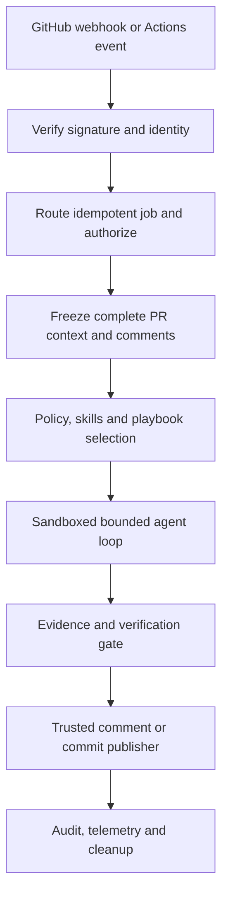
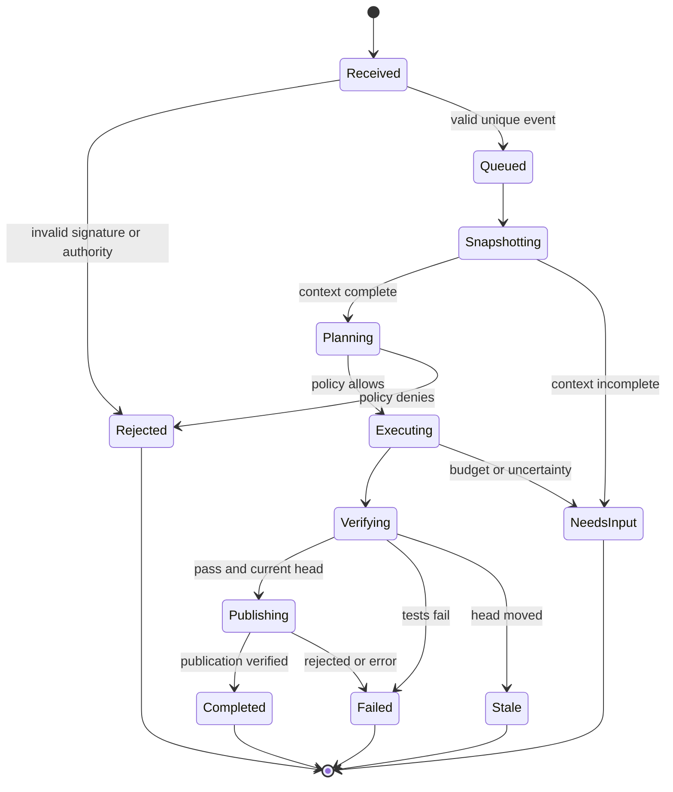

# Architecture and interface contracts

Architecture follows existing Rust surfaces. Proposed modules are explicitly marked `NEW` and should not be claimed to exist yet. Prefer inserting small types into existing modules until a boundary demonstrably warrants a new module.

## End-to-end sequence

## Trust zones

1. **External GitHub zone:** PR files, comments, review text, labels, usernames, webhook payload fields; all potentially adversarial data.
2. **Trusted intake:** verify signature over original bytes, event type, installation association, allowed repository and delivery-id dedupe. GitHub Actions `GITHUB_TOKEN` environment is scoped to the job.
3. **Trusted coordinator:** identity, authorization, policy compilation, worker assignment, token issuance, publication. No untrusted model output may escalate privileges.
4. **Untrusted model/tool zone:** LLM prompts/tool calls, repository content and all tools reading it. Worker has no App private key, no GitHub write token, no cloud credentials, no host Docker socket.
5. **Trusted publisher:** separate role; verifies branch/head SHA/permission/verification evidence and pushes exact committed diff or posts comment.

## Component ownership map

| Existing path | Scope to extend | Proposed interface |
|---|---|---|
| `src/github/webhook.rs`, `src/server/handlers.rs` | Signature, event routing, installation scope | `VerifiedEvent` parsed only after trusted signature; `delivery_id` dedupe. |
| `src/workflow/context.rs` | PR snapshot and threaded conversations | `PrSnapshot { head_sha, diff, changed_files, messages, completeness }`. |
| `src/workflow/command.rs` | Explicit mention parsing, permissions, origins | `CommandIntent { actor, verb, quoted_or_ignored, parent_id }`. |
| `src/agent/runner.rs` | Bounded multi-turn loop and checkpoint | `AgentJob`, `AgentStep`, typed outcome/status. |
| `src/agent/tools.rs` | Mode-scoped tool registry | `CapabilitySet`, deny on unknown tool; independent post-generation policy check. |
| `src/skills/discovery.rs`, `src/skills/prompt.rs` | Skill metadata and scoped loading | `SkillSelection`, `SkillUseEvidence`. |
| `src/workflow/coordinator.rs` | Playbook preconditions and job state transitions | `JobStateMachine`, `PlanStep`, `PlaybookDecision`. |
| `src/workflow/publisher.rs` | Review comments and authorized commits | `PublishRequest { expected_head_sha, permission_proof, verification }`. |
| `src/llm/traits.rs` | Multiple BYOK providers | `LlmProvider` adapter with tool call and usage semantics. |
| `src/sandbox/traits.rs` | Worker containment | Isolated read/write/exec methods with network, resource and path constraints. |
| **NEW** `src/workflow/conversation.rs` | Versioned message graph | `ConversationGraph`, `ReplyTarget`, event identity. |
| **NEW** `src/skills/playbook.rs` | Typed playbook validation | `PlaybookManifest`, constrained execution plan. |
| **NEW** `src/workflow/checkpoint.rs` | Recoverable jobs | Checkpoint per step/sha/policy identity. |
| **NEW LATER** `src/semantic/` | Language-specific symbol diff | `SymbolDelta`, `Relation`, `CandidateFinding`. |

## Proposed state machine

Terminal failure statuses carry typed reasons and must not be silently reported as `Completed`.

## Conversation semantics

- Normalize GitHub **issue comments**, **PR review submissions**, **inline review comments and replies**, and PR metadata without flattening away IDs/parents, GitHub actor identity, edit timestamps or target commit.
- Causal key `installation_id / repo_id / pr_number / delivery_id / event_action / comment_id / updated_at` for event dedupe; prefer stable provider IDs over text hash. Duplicate deliveries return existing job identity.
- Accept command only from explicit mention parsed in allowed event types. Bot output is evidence-only unless a maintainer explicitly responds with an authorized command. No bot bot call-and-response feedback loops; skip self-authored and configured bot-authored triggers by policy.
- Latest comments may arrive after snapshot. On follow-up, include bounded previous thread history and recalculate headSHA before action. Existing job does not automatically expand authority based on changed text.
- Every message has `trust_level=untrusted_user_content` irrespective of account type. Authorization derived separately from GitHub permissions and policy.

## Skills and playbooks

- Skills are **untrusted project-authored guidance**. Existing `SKILL.md` discovery parses frontmatter and rejects symlink traversals. Never let a skill override system safety, host config or tool permissions.
- Playbook = typed workflow with name, revision/source digest, scope, prerequisites, bounded steps and declared checks. Treat YAML/JSON as data; do not `eval` script snippets from it.
- Create `SkillUseEvidence`: selection reason, content digest, steps requested, steps attempted, result and independent test or static-check evidence. `selected` does not imply `applied`.
- Existing skill source order and collision policy must be made deterministic and documented; repo skill cannot impersonate built-in security policy.

## Agent reasoning / execution loop

`Snapshot -> plan -> choose bounded tool -> validate capability -> execute isolated -> observe -> update plan -> validate claims -> verify -> publish`.

- Preserve structured per-step history until budget/time limit; overflow must be explicit.
- Fix can modify multiple files but every path must remain within allowed checkout. Track pre/post SHA, file manifest, diffstat and tests.
- Retry transient API/model errors with backoff and idempotency. Do not auto-retry an already-published mutation without checking published SHA.
- Detect repeated identical tool call/output loops, escalating token consumption and repeated failing tests; stop with `NeedsInput` or `Failed`.
- Restrict subprocess, mounts, outbound traffic, working directory, CPU/memory/time and installed credentials; subject to chosen sandbox engine guarantees.

## Model provider contract

Provider adapters must normalize: messages, tool declarations, tool call IDs/results, error classes, usage, max output and cancellation. Preserve provider-specific limits in capability metadata, not stringly typed prompt hacks. Validate OpenCode/OpenRouter model-routing separately from OpenAI/Anthropic direct APIs. A compliant adapter supports a fixture contract: tool call -> tool output -> second model response -> finish. Do not log user keys or raw provider auth headers.

## Semantic extension (conceptual inspiration only)

Entity diff stage extracts changed symbols in Rust, JS/TS and Python, retaining source spans and parser coverage. Relation graph conservatively adds callers/importers/test references, with a depth/file budget. Risk scoring considers code exposure, changed logic, validation boundaries and blast radius, but scores only determine review priority. Every emitted vulnerability finding still needs code-evidence validation. If parsing fails, fall back to textual review and mark coverage; no hidden 'all clear'.
