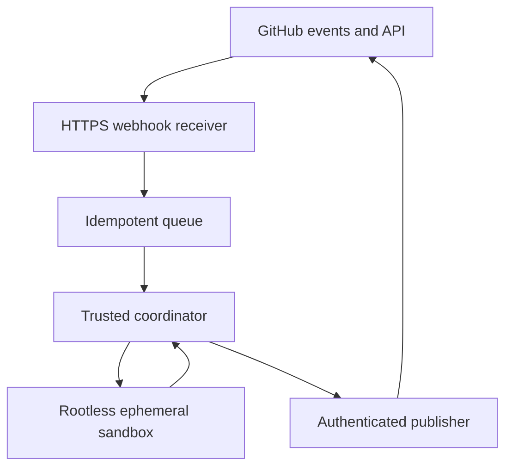

# Two deployment paths

## A. GitHub-native Action (first usable release path)

### Workflow contract

Reuse `action.yml`, `examples/github-actions.yml` and `src/action.rs`. Install the composite Action in a consumer repo, define minimal `permissions`, and supply a provider key in Actions Secrets or an environment secret store. Recommended events must be split by trust:

- For review of untrusted fork code, use safe read-only `pull_request` where possible.
- For comment-driven commands, the event workflow may read metadata first, but must **not** checkout and execute untrusted fork code with elevated secrets under `pull_request_target`. Design an isolated uncredentialed worker or explicitly deny unsafe forks.
- `workflow_dispatch` may provide an authenticated operator-only manual retry/fix route. Never assume arbitrary commenters have privileged GitHub API access.

Minimal illustrative workflow, **not yet a validated drop-in replacement for the repo example**:

```yaml
name: OpenReview
on:
  issue_comment:
    types: [created]
  workflow_dispatch:
permissions:
  contents: read
  issues: write
  pull-requests: write
jobs:
  review:
    if: github.event_name == 'workflow_dispatch' || github.event.issue.pull_request != null
    runs-on: ubuntu-latest
    steps:
      - uses: actions/checkout@<PINNED_COMMIT_SHA_OF_TRUSTED_ACTION>
      - name: Execute OpenReview
        uses: imMamdouhaboammar/openreview@<PINNED_VERIFIED_RELEASE_TAG_OR_SHA>
        with:
          provider: opencode_custom
          model: ${{ vars.OPENREVIEW_MODEL }}
          # Map a documented input name and secret from action.yml.
          # Never interpolate untrusted comment content into shell command text.
```

This example is intentionally schematic: `on`/`if` and the specific action inputs must be reconciled against the actual `action.yml` before release; placeholders prohibit blind copy/paste. Production install docs must include complete tested YAML, correct provider secret and capability mapping, permissions for authorized Fix and a safe default Review route.

### BYOK providers

| Provider family | Configuration required | Verification |
|---|---|---|
| OpenCode / OpenCode Custom | API key or supported endpoint credentials, exact model route, protocol/base URL according to adapter | Fixture + real test through configured endpoint; no fallback to another provider without explicit opt-in. |
| OpenRouter | OpenRouter key, provider/model ID and compatible API URL | Tools, errors, usage + second-turn contract. |
| Anthropic | Anthropic API key and supported model | Direct adapter contract. |
| OpenAI | OpenAI key and supported model | Direct adapter contract. |
| Gemini / Ollama | Optional supported routes if already present | Explicit pass/fail/unsupported matrix. |

Operator does not supply model keys for other users. Provider credentials remain in the owner's secrets; only pass to the trusted model-client boundary. Do not expose them to untrusted repo shells.

### Actions release gate

Consumer repo demonstrates: install -> `@openreview review` -> reply on correct PR -> authorized Fix -> sandboxed edits -> real tests -> branch push -> commit SHA reporting -> CI triggered or explicitly dispatched and observed. Distinguish **passed initial E2E** from **verified post-push checks**, because `GITHUB_TOKEN` events do not always create another workflow run.

## B. Self-hosted GitHub App

### Deployment topology



- **Control plane**: HTTPS webhook ingress, signature validation, job queue, per-install policy, token issuance, status and audit storage.
- **Worker plane**: isolated rootless unprivileged worker, no secrets, ephemeral checkout/tool execution. No direct host Docker socket binding from untrusted worker.
- **Persistence**: encrypted operational state for dedupe/checkpoint; do not persist raw PR contents beyond documented retention unless required and consented.
- **Tenant mapping**: validated installation ID + repository ID, event/repo allowlist and installation revocation handling.

### Operator setup steps

1. Register GitHub App, select documented event subscriptions and minimum permissions, configure HTTPS callback and secret.
2. Store App ID, private key and webhook secret in operator secret manager (not in source or worker env).
3. Deploy receiver and trusted coordinator. Confirm HMAC verification and App JWT to installation-token exchange.
4. Deploy rootless uncredentialed sandbox worker with CPU/memory/time/network limits.
5. Install App into two separate test repos. Verify independent tokens and data isolation.
6. Exercise permissions revoked, installation removed, repository removed, rotated key and duplicated/out-of-order webhooks.
7. Test Review and authorized Fix, including context, skill resolution, verification and published SHA.
8. Publish operator runbook for backup, update, secret rotation, monitoring, stop/restart and cleanup.

### The hosting reality

GitHub hosts Actions job execution and webhook delivery, not arbitrary always-on GitHub App backends. A self-hosted App therefore needs a reachable backend and worker infrastructure. The action distribution mode can serve many users without an always-on central backend, using each repository's Actions quota and BYOK keys, but it does **not** eliminate Actions quotas or trust restrictions.

## Shared service level expectations

- Config validate on startup with safe fail-closed errors.
- Health/readiness probes for receiver, queue, publisher and workers.
- Structured events: `job_id`, scope, `head_sha`, state transition, duration, token/step counts, tool failure class, output links, no secrets.
- Operator can cancel running jobs and pause a compromised installation.
- A disconnected model endpoint yields bounded error and retryable state rather than fabricated success.
- Updates must not silently change accepted provider behavior or privilege scope.

## Required deployment artifacts to add in repository

- Exact tested `examples/github-actions.yml` with real `action.yml` input mapping and explanatory README.
- Operator App deployment guide, environment-variable schema, permissions/events manifest, rootless smoke script and example production configuration with no secrets.
- A `ci/e2e` or scripts-based reproducible test fixture demonstrating multi-install and Actions routes; link run IDs and SHA in release evidence.
