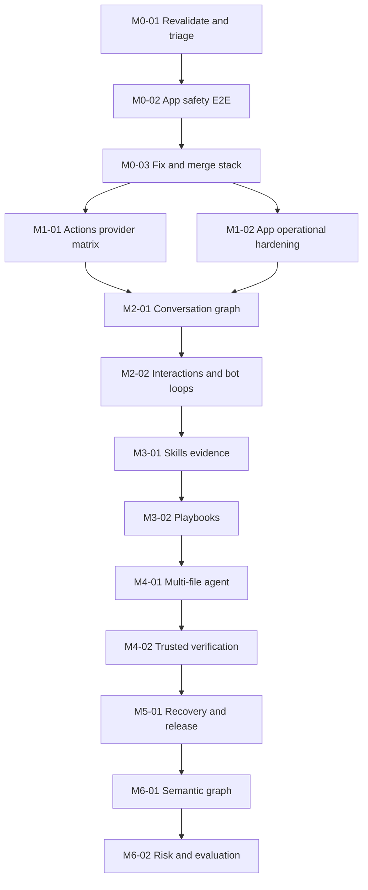

# OpenReview Agentic Platform Implementation Plan

> **For agentic workers:** Use the host's available task-by-task implementation workflow. Steps use checkbox (`- [ ]`) syntax for tracking. A card is not completed until test evidence and updated docs exist.

**Goal:** Merge the existing OpenReview PR stack safely and deliver authenticated, multi-provider, project-aware GitHub review and Fix agents via Actions BYOK and a self-hosted GitHub App, followed by independently authored semantic review.

**Architecture:** Reuse Rust Axum webhook/CLI, workflow coordinator, model provider interfaces, skills loader, sandbox runner and trusted publisher. Add typed conversation history, playbook enforcement, job checkpoints and later independent semantic symbol graph. Keep trust and permissions enforced by host code, not by model text.

**Tech Stack:** Rust edition 2024, Axum/Tokio/Serde, GitHub REST/Webhooks/Actions, Docker rootless workers, existing provider adapters. Evaluate tree-sitter or native parsers for semantic review only after coverage benchmark. Do not add unexplained dependencies.

## Global constraints

- Current GitHub source state in `BASELINE_AND_EVIDENCE.md` is a dated snapshot. Re-query before each mutation.
- Only work on approved repo/branch; preserve Codespace user changes. Each feature or fix gets its own narrow PR where practical; nested stack updates need documented ancestry.
- TDD for all deterministic logic; first prove RED (regression or new acceptance), then GREEN, then integration. No forced number of commits.
- Neither test success nor `CLEAN` alone authorizes merge. `MERGE_AND_RELEASE_RUNBOOK.md` is binding.
- No untrusted code executed with secrets. Tool permission checks exist in server-side code, with rootless isolated Fix worker and trusted publisher.
- No claim of vulnerability detection unless a finding is reproducible or accurately labeled uncertain.
- All new JSON schemas in `CONTRACTS/` are **proposals** until implementation and versioning are approved.

## Dependencies

Some preparatory writing/fixture tasks may run in separate PRs while another card is blocked. Do not publish a dependent runtime feature until its predecessor is accepted.

---

## Milestone M0: Real stabilization and merged PR stack

### Task M0-01: Revalidate repository, blockers and head SHAs

**Files:** Existing `security/REVIEW_EVIDENCE.md`, `.github/workflows/ci.yml`, PR comments; new small evidence ledger under an approved docs path. No speculative code edits.

**Interfaces:** consumes GitHub PR/check/status/review data and authorized Qlty detailed findings; produces written `merge_gate_snapshot` and blocker list per PR.

- [ ] Fetch all three PR heads, bases, reviews, checks, Qlty details, branch protection and local Codespace status.
- [ ] Write a failing targeted test for each confirmed code defect; classify others as environment or authorization blockers.
- [ ] Record test command, failure and affected file before touching code.
- [ ] Resolve required auth/permission access through owner, never assume visibility of private security issues.
- [ ] Refresh evidence ledger and stop when any required gate remains unknown.
- [ ] Commit only a deliberate evidence file if user authorizes repo modifications; no unrelated local state.

### Task M0-02: Prove App multi-install and rootless safety

**Files:** Existing `src/github/{auth,webhook}.rs`, `src/server/handlers.rs`, `src/sandbox/{docker,traits}.rs`, `docker-compose.yml`, `scripts/verify-rootless-sandbox.sh`; tests under `tests/`.

**Interfaces:** valid GitHub App event -> scoped installation token -> rootless job -> verified read/write action; produces APP-01..05 + SEC-01..03 evidence.

- [ ] Add RED fixtures for wrong installation, revoked app, duplicate webhook and cross-install repo access.
- [ ] Patch only confirmed path from failures; retain raw-body HMAC checks and deny ambiguous scope.
- [ ] Verify no worker has App private key or publisher token; rootless isolation smoke in target configuration.
- [ ] Run Rust tests, sandbox tests and live two-install E2E in authorized lab repositories.
- [ ] Verify cleanup, logs, token rotation and exact installation IDs.
- [ ] Record App evidence and commit focused fixes before removing PR1 merge hold.

### Task M0-03: Remediate remaining PR blockers, then merge

**Files:** Only targeted files evidenced in M0-01, tests and PR descriptions. No broad autoformat outside touched files.

**Interfaces:** consumes audited blockers/current SHA; produces merged main SHA plus post-merge checks, or explicit `BLOCKED`.

- [ ] Write RED regression for each confirmed blocker and fix it with smallest coherent patch.
- [ ] Run fmt/clippy/tests/audit/container/rootless workflows at the current head.
- [ ] Post evidence to open review threads and validate Qlty findings with their owners.
- [ ] Recheck App E2E, branch protection, required reviews and all PR merge conditions.
- [ ] Merge #1 to `main`, then rebase/retarget and verify #2, then #3, never forcing history without authorization.
- [ ] Verify `main` checks and publish a merge-evidence summary with SHA/links.

---

## Milestone M1: Deployability and provider reliability

### Task M1-01: Provider contract matrix and complete Actions example

**Files:** `action.yml`, `src/action.rs`, `src/llm/{traits,anthropic,openai,responses,gemini}.rs`, `examples/github-actions.yml`, `tests/`.

**Interfaces:** configured provider + model + secrets -> one or more tool calls -> normalized agent result; produces ACT-01..05.

- [ ] RED fixture for each required OpenCode/OpenRouter/Anthropic/OpenAI tool-call second-turn response and error.
- [ ] Align adapter capability/error/usage contract without changing unrelated provider behavior.
- [ ] Define safe Review vs authorized Fix event/workflow routes with real action input names.
- [ ] Test invalid keys, rate limits, missing model and secret redaction.
- [ ] Run one real OpenCode BYOK E2E and record run; annotate other live providers `SKIPPED` until supplied.
- [ ] Pin release reference, update tested install guide, commit and attach evidence.

### Task M1-02: Operational App release path

**Files:** `src/server/{state,handlers,routes}.rs`, `src/jobs/`, `src/github/auth.rs`, Docker/compose and new `docs/deployment-app.md`.

**Interfaces:** installation lifecycle events + queue -> authorized worker outcome with audit; produces multi-install repeatable smoke artifacts.

- [ ] RED tests for installation removal, token renewal, health failures and job isolation.
- [ ] Implement narrow lifecycle/secret/config gaps confirmed by tests.
- [ ] Add health, readiness and reproducible setup instructions; no real keys committed.
- [ ] Validate rootless runtime, live install revoke/reinstall and worker cleanup.
- [ ] Add bounded operational smoke to CI without requiring public secrets.
- [ ] Commit and publish App operator checklist.

---

## Milestone M2: PR conversations and bot coexistence

### Task M2-01: Full conversation snapshot

**Files:** `src/workflow/context.rs`, `src/github/client.rs`, **NEW** `src/workflow/conversation.rs`, tests.

**Interfaces:** GitHub pages of comments/reviews/threads -> versioned `conversation-event` records and complete snapshot; test CONV-01/02/06.

- [ ] RED test with 101+ comments, inline replies, edits and race between head reads.
- [ ] Fetch all relevant pages preserving IDs, actor, timestamp, parent, path/line and commit association.
- [ ] Reject/label partial contexts instead of presenting complete coverage.
- [ ] Freeze head SHA and invalidate stale results on movement.
- [ ] Verify count/order and malformed event handling with fixture + integration.
- [ ] Commit typed contract and concise docs.

### Task M2-02: Interactive routing, reply placement and loop prevention

**Files:** `src/workflow/command.rs`, `src/workflow/coordinator.rs`, `src/workflow/publisher.rs`, `src/github/webhook.rs`, tests.

**Interfaces:** authorized mention + source event -> one idempotent job -> contextual thread reply; test CONV-03/04/05.

- [ ] RED tests for quoted mention, bot text, self-trigger, duplicate deliveries and edited comments.
- [ ] Parse explicit commands only in eligible comments; separate command intent from quoted data.
- [ ] Check actor permission and enforce policy at admission and before publish.
- [ ] Reply in thread where possible; fallback with stable permalink.
- [ ] Exercise other-bot comments as evidence without accepting their claimed authority.
- [ ] Commit with E2E conversation replay and anti-loop proof.

---

## Milestone M3: Project awareness

### Task M3-01: Skills provenance and applied-step evidence

**Files:** `src/skills/{discovery,frontmatter,prompt}.rs`, `src/agent/{runner,prompt}.rs`, tests.

**Interfaces:** SKILL.md manifest -> applicability selection -> load -> observed use evidence; test SK-01/02/04/05.

- [ ] RED tests for symlinks, name collisions, malformed frontmatter and irrelevant skill.
- [ ] Make deterministic selection and content digest with clear size/path bounds.
- [ ] Distinguish selected, loaded, attempted, applied, verified and not-applicable.
- [ ] Prevent skill text from altering available tools or security checks.
- [ ] E2E that a concrete skill changes agent output/verification as instructed, with test oracle.
- [ ] Commit, document evidence fields and precedence.

### Task M3-02: Typed playbook runtime

**Files:** **NEW** `src/skills/playbook.rs`; `src/workflow/coordinator.rs`, `src/agent/runner.rs`, tests and playbook fixtures.

**Interfaces:** validated playbook schema + job scope -> constrained planned steps/checks; test SK-03/04.

- [ ] RED fixtures for failed preconditions, illegal requested shell and policy-widening playbook.
- [ ] Parse versioned schema and enforce allowed operations explicitly.
- [ ] Map playbook step results to trusted tool and test evidence, never model attestation only.
- [ ] On failure produce `blocked`/`failed` with original step ID and no hidden next step.
- [ ] Run malicious repository policy tests and end-to-end documented example.
- [ ] Commit schema, fixtures and operator guidance.

---

## Milestone M4: Real coding agent

### Task M4-01: Recoverable multi-file planning and execution

**Files:** `src/agent/{runner,tools}.rs`, `src/workflow/coordinator.rs`, **NEW** `src/workflow/checkpoint.rs`, tests.

**Interfaces:** authorized request + complete snapshot + policy -> bounded step plan -> search/log/code diagnostics and multi-file diff/checkpoints; test FIX-01/05/06 and TOOL-01..03.

- [ ] RED test: repair a cross-module regression requiring code and test edits; fail with current behavior when unsupported.
- [ ] Capture explicit plan and tool evidence per step, enforce budgets/loop detection/cancel.
- [ ] Expose bounded read-only `searchRepository` and `getPullRequestChecks`/redacted log tools without granting Review a shell.
- [ ] Execute only mode-authorized sandbox tools and constrain paths/resources.
- [ ] Retry errors by class with idempotency; preserve recoverable checkpoints.
- [ ] Verify targeted tests plus full relevant suite and compare final diff to authorized scope.
- [ ] Commit and document explainable partial/incomplete outcomes.

### Task M4-02: Trusted independent verification and publication

**Files:** `src/workflow/{verification,publisher}.rs`, `src/github/client.rs`, sandbox traits/tests.

**Interfaces:** verified patch + current actor/PR/head -> safe publication with exact SHA; test FIX-02/03/04 + SEC-08/10.

- [ ] RED test for model claiming passed tests while real command failed, and head mutation before push.
- [ ] Keep verification outside LLM trust, record raw exit code and test digest.
- [ ] Recheck actor permission/installation/token and branch protection before publication.
- [ ] Ensure no force and no mutation on review/suggest paths.
- [ ] Confirm server commit SHA and subsequent check status in live lab.
- [ ] Commit focused hardening and evidence.

---

## Milestone M5: Operability and release

### Task M5-01: Job control, telemetry, failure/retry and stable release

**Files:** `src/jobs/`, `src/server/state.rs`, `src/workflow/checkpoint.rs` if created, `docs/`, CI and tests.

**Interfaces:** received event to terminal outcome with trace and resource record; test OPS-01/02/03 and SEC-09/11.

- [ ] RED tests for duplicate job on retry, cancellation, restart and rate-limit behavior.
- [ ] Implement bounded backoff, cleanup, redacted metrics and health endpoints.
- [ ] Run soak/recovery and release security regression suite.
- [ ] Verify docs, provider support matrix and tested Action/App install paths.
- [ ] Publish release candidate, re-run live end-to-end on tagged SHA.
- [ ] Document rollback and operator handoff before declaring R2 ready.

---

## Milestone M6: Independent semantic review

### Task M6-01: Entity-level diff and bounded dependency graph

**Files:** **NEW LATER** `src/semantic/{mod,parser,graph,diff}.rs`, `src/workflow/context.rs`, fixtures/tests.

**Interfaces:** source diff + allowed repo snapshot -> typed `SymbolDelta` and bounded neighborhood with coverage; test SEM-01/02/05.

- [ ] RED fixture for changed Rust function and related callers, plus TS/Python sample.
- [ ] Evaluate parser libraries for license, coverage, performance and maintenance.
- [ ] Implement independent symbol/span extraction and bounded import/call references.
- [ ] Preserve precise source SHA/path/line and explicit parse failures.
- [ ] Compare graph coverage and latency against textual baseline.
- [ ] Commit only independently authored code and license report.

### Task M6-02: Risk-aware review lenses and calibration

**Files:** **NEW LATER** `src/semantic/{risk,validation}.rs`, `src/agent/prompt.rs`, benchmark fixtures/tests.

**Interfaces:** candidate symbols + code evidence -> ranked verified/unverified findings; test SEM-03/04.

- [ ] RED benchmarks on known bugs and benign refactors, including false-positive controls.
- [ ] Add deterministic risk features and explicit budgets, not opaque 'security score' authority.
- [ ] Validate candidate findings against code path and reproduction when feasible.
- [ ] Measure precision, recall, review cost, latency and context coverage with stated limitations.
- [ ] Add gradual opt-in and no-parser fallback, avoid code reuse from Inspect.
- [ ] Release only if measured added value and regression safety meet agreed thresholds.

## Final acceptance

R1 needs M0+M1; R2 needs M2-M5 in addition; R3 adds M6. Each shipped capability must map to tests in `TEST_AND_EVIDENCE_MATRIX.md`, an authorized CI/lab run and a published SHA. Pending gates remain `BLOCKED`, never silently counted complete.
