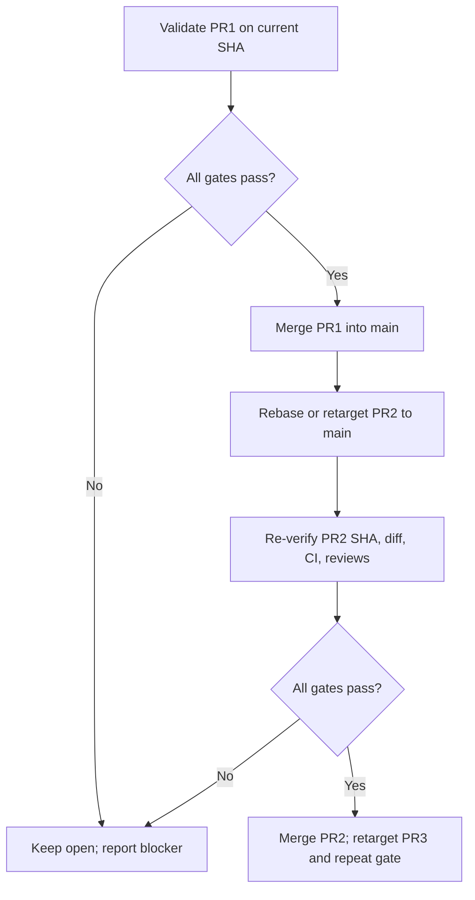

# M0 merge readiness and release control

**Do not execute this runbook until acting agent has authorization to change the repository.** The ZIP request is documentation only.

## Preparatory checks

1. Re-fetch PR #1/#2/#3 refs, HEAD SHA, base, merge state, ruleset, required reviews, CI and discussion threads. Store links and values in an evidence ledger.
2. Inspect local Codespace `git status`, worktrees, remotes and untracked files read-only. Preserve user-owned `.gitignore` change or any later changes; stage only intentional changes by path.
3. Verify current PR ancestry using `git merge-base` and `gh pr view`. Treat changes to current branch while planning as new inputs requiring re-evaluation.
4. Retrieve actual Qlty blocking findings in authenticated UI or API. Classify exact file/rule/severity/exploitability/repro; validate with local test or reliable evidence. If access unavailable, leave `BLOCKED`, don't merge.
5. Recheck PR body DO NOT MERGE language. Resolve conditions with actual multi-install App + rootless evidence before changing merge policy.
6. Confirm all required CI and review rules through GitHub, not a copied screenshot. Ensure commit SHA matches the tested head.

## Fix / commit protocol

- One fix branch per independent blocking issue or coherent behavior; no unrelated bulk rewrite.
- Reproduce defect or missing contract via a failing test; keep its failure output in PR description when useful.
- Change only verified files, add regression, run `cargo fmt --check`, `cargo clippy --all-targets --all-features -- -D warnings`, `cargo test --all-features`, `cargo audit`, container/sandbox jobs as relevant. Match exact repository CI commands when differ.
- Review `git diff --check` and staged diff, stage exact files with `git add -- path1 path2`, never `git add -A` on dirty user workspace.
- Commit by logical unit with factual message and push to existing PR branch. Confirm server head and CI rerun.
- Respond to real review threads with path/test evidence, then resolve only when fixed or factually invalid. Do not dismiss reviews to create an apparent green state.

## Stacked merge algorithm

Precondition: PR #1 is verified safe and no merge hold remains.

1. Merge #1 using repository-approved strategy and verified SHA.
2. Rebase or retarget #2 **with care**. Avoid force push; if history rewrite is necessary, stop and seek specific authorization, or choose a non-force branch strategy (fresh branch/PR) with traceability.
3. Confirm #2 diff now excludes already-landed #1 changes. Rerun checks against its new base/head; change draft to ready only after blockers cleared.
4. Merge #2; perform same retarget/ancestry/check cycle for #3. Do not accidentally merge #3 into #2's old feature branch.
5. Recheck `main` final tree and CI after each merge, including security and sandbox flows. If a child becomes obsolete/equivalent, explain and close it only with approval and verified equivalence.

## Merge gate table

| Gate | Required | Evidence |
|---|---|---|
| Auth and scope | Owner authorized push/merge on exact PR and base | Explicit user instruction / repo rules |
| Diff integrity | No unexpected user files; current head known | `git status`, diff, sha |
| Rust/unit/integration | Pass | Current CI and local results |
| Dependency/container/rootless | Pass where applicable | Current CI logs and isolation probe |
| Qlty/security issues | All verified resolved or substantiated false positive per required policy | Triage ledger, test/reviewer links |
| App co-hosting | Two-install authenticated E2E, token isolation, rootless worker | Test artifacts and run IDs |
| Review conditions | Required approval and threads complete | GitHub API/UI |
| Draft/branch protections | Ready, mergeable; checks on exact head | GitHub verified state |
| Stacked ancestry | Correct target `main` after prior landing | Compare + merge-base |
| Post-merge | `main` checks, smoke and changed code confirmed | Merge SHA, run links |

## Rollback and incident handling

- If a merge later causes confirmed regression, prefer `git revert` via reviewable PR. Do not rewrite `main` or delete branches to conceal evidence.
- If a feature branch is corrupted, stop; preserve refs, identify last known good SHA and propose a new corrective branch. Destructive reset/force push requires fresh explicit permission.
- If App tokens or provider keys leak, revoke/rotate in secret manager and pause affected installations; avoid pasting secrets into issue body.
- If post-push CI did not fire because of token semantics, explicitly trigger the documented authorized workflow and observe result. A passing pre-push run is not post-push proof.

## Hand-off after each PR

Report PR URL, head/merge SHA, exact files altered, test names and links, unresolved risks, Qlty disposition and whether main is green. If still blocked, present exact missing evidence and owner action rather than a fake completion.
