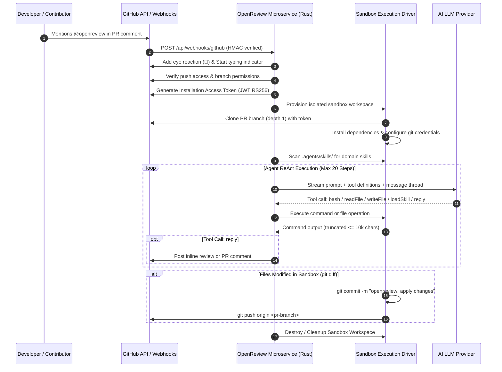

# Replica Reconnaissance Map: OpenReview

Clean-room reverse-engineering analysis of `vercel-labs/openreview` (Commit: `672deb21e70e471e0536d5ad7a67c14b8359e97e`).

---

## 1. Scope & System Definition

- **System Target**: OpenReview AI Code Review Bot & Autonomous Assistant.
- **Source Architecture**: Next.js 16 + Vercel Workflow + Vercel Sandbox + Chat SDK + AI SDK (TypeScript).
- **Target Architecture**: High-Performance Self-Hosted Rust Microservice (`openreview-rs`) with Axum, Tokio, async GitHub App engine, pluggable execution sandboxes (Local Container/Process & Docker OCI), multi-provider LLM client (Claude, OpenAI, Gemini), and progressive skill discovery.
- **Target Audience**: Engineering teams, open-source maintainers, and enterprise organizations seeking secure, self-hosted, vendor-agnostic automated PR code reviews without proprietary cloud sandbox lock-in.

---

## 2. Evidence & Source Traceability

| Source | Target / Reference | Value Derived |
| :--- | :--- | :--- |
| `github.com/vercel-labs/openreview` | Commit `672deb21e7` | Core repository architecture, dependencies, bot event flows |
| `app/api/webhooks/route.ts` | SHA-256 `091de22224` | GitHub webhook ingestion & `waitUntil` background job invocation |
| `workflow/index.ts` | SHA-256 `51cfd157b1` | Linear durable workflow steps: push access, sandbox, git config, agent run, diff commit |
| `lib/bot.ts` | SHA-256 `323aa8fbfc` | Event dispatching: `onNewMention`, `onSubscribedMessage`, `onReaction` |
| `lib/agent.ts` | SHA-256 `40b3aa1673` | Prompt template, system instructions, GitHub suggestion markdown syntax, tool definitions |
| `workflow/steps/create-sandbox.ts` | SHA-256 `468e9cf42a` | Vercel Sandbox provisioning, depth 1 clone with GitHub installation token |
| `workflow/steps/install-dependencies.ts`| Source step | Package manager detection (`bun`, `pnpm`, `yarn`, `npm`) and `gh` CLI installation |
| `.agents/skills/` | Repository directory | Progressive skill discovery: frontmatter parsing (`name`, `description`) and runtime lazy-load |

---

## 3. Surface & Trigger Inventory

| ID | Interface / Endpoint | Ingress / Route | Purpose | Key Parameters / Payloads | States |
| :--- | :--- | :--- | :--- | :--- | :--- |
| **S01** | Webhook Receiver | `POST /api/webhooks/github` | Ingests GitHub App webhook payloads with HMAC-SHA256 signature verification | `X-Hub-Signature-256`, `X-GitHub-Event`, JSON body | Signed, InvalidSig, Queued, Ignored |
| **S02** | Service Health & Metrics | `GET /health` & `GET /metrics` | Liveness/readiness probe, uptime, active reviews count, memory stats | HTTP 200 JSON `{ "status": "ok", "version": "..." }` | Healthy, Degraded |
| **S03** | Status & Web View | `GET /` | Clean status landing page detailing service capabilities and active configuration | HTML / Markdown render | Online |
| **S04** | GitHub PR Thread Comment | GitHub PR Conversation | Receives user mention `@openreview`, adds reaction `👀`, streams review comments | Markdown body with suggestion blocks | Pending, In-Progress, Approved, ChangesRequested |
| **S05** | Reaction Event Receiver | GitHub PR Reaction Webhook | Triggers commit application on `+1`/`heart`; acknowledges skip on `-1`/`confused` | Comment ID, Reaction type | Dispatched, Acked |
| **S06** | Standalone CLI Reviewer | `openreview review --pr <num>` | Allows engineers and CI pipelines to run reviews locally without webhooks | PR number, repository, dry-run flag | Run, Success, Error |

---

## 4. Core User & Event Flows



- **F01: On-Demand PR Review Mention (`@openreview`)**
  - Trigger: Comment created on PR or review thread containing `@openreview`.
  - Happy Path: Verify signature -> React with `👀` -> Fetch PR details -> Verify write access -> Launch Sandbox -> Clone PR branch -> Discover skills -> Run ReAct agent -> Output line-level comments with ````suggestion blocks -> Terminate sandbox.
- **F02: Reactive Code Application (Reaction `👍` or `❤️`)**
  - Trigger: User reacts with thumbs up or heart to an OpenReview comment.
  - Action: Microservice loads stored thread context -> runs workflow with instructions to apply the accepted suggestion -> pushes commit directly to PR branch.
- **F03: Skip Reaction (Reaction `👎` or `😕`)**
  - Trigger: User reacts with thumbs down or confused.
  - Action: Microservice posts polite acknowledgment comment and skips execution.
- **F04: Local / CI Direct Review Run**
  - Trigger: Engineer runs CLI command `openreview-rs run --repo owner/repo --pr 123`.
  - Action: Runs review loop directly in local workspace without requiring GitHub App webhook daemon.

---

## 5. Inferred Data Model

```
ThreadState
  ├── thread_id: String (primary key)
  ├── repo_full_name: String
  ├── pr_number: u64
  ├── base_branch: String
  ├── pr_branch: String
  ├── updated_at: DateTime<Utc>
  └── messages: Vec<ThreadMessage>
        ├── role: "user" | "assistant" | "system" | "tool"
        └── content: String

SkillMetadata
  ├── name: String
  ├── description: String
  └── content: String (Markdown body)

SandboxConfig
  ├── work_dir: PathBuf
  ├── timeout: Duration
  ├── env_vars: HashMap<String, String>
  └── driver: "local_process" | "docker_container"

ReviewOutcome
  ├── comments_posted: usize
  ├── commits_pushed: usize
  ├── tokens_used: usize
  └── execution_time_ms: u64
```

---

## 6. What Cannot Be Cloned & Clean-Room Substitutions

1. **Vercel Sandbox (`@vercel/sandbox`)**: Proprietary closed cloud microVM service.
   - *Clean-Room Replacement*: Pluggable Rust execution driver supporting:
     - **Local Ephemeral Directory**: Fast, sandboxed temporary filesystem with environment isolation, process timeouts, and credential scrubbers.
     - **Docker / Podman OCI Sandbox**: Fully isolated container instance with dedicated mount, cgroups, memory and CPU limits.
2. **Vercel Workflow Engine (`workflow`)**: Proprietary cloud durable execution runtime.
   - *Clean-Room Replacement*: In-memory / Tokio task supervisor with state store (in-memory LRU + optional Redis) and deterministic step checkpointing.
3. **`@chat-adapter/github`**: Heavy NPM library for GitHub chats.
   - *Clean-Room Replacement*: Native Rust webhook handler with constant-time HMAC-SHA256 signature verification, RS256 JWT GitHub App authentication, and Octocrab / Reqwest client.
