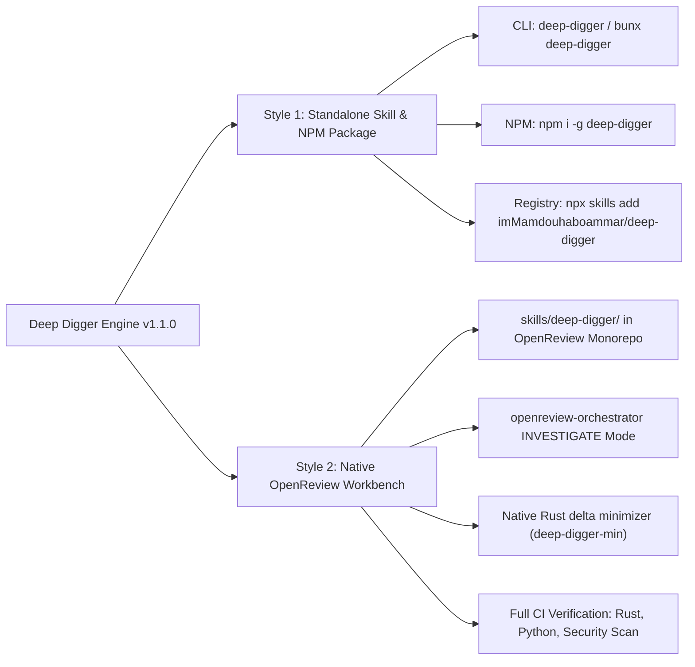

# Causal Investigation & Minimization with Deep-Digger

When a pull request introduces a regression, flakiness, or test crash that cannot be diagnosed from inspection alone, the orchestrator invokes the `deep-digger` subsystem.

---

## 1. Deep Digger Dual Operating Styles

Deep Digger operates seamlessly in two distinct styles across the ecosystem:



1. **Standalone Skill & NPM Package:**
   Distributed via npm (`deep-digger`) and registered in universal agent registries (`npx skills add imMamdouhaboammar/deep-digger`). Features zero-dependency packaging (`dist/`), independent CLI entrypoint (`bin/cli.js`), automated postinstall linking, and self-contained doctor diagnostics.

2. **Native OpenReview Investigation Subsystem:**
   Resides directly inside OpenReview under `skills/deep-digger/` and `.agents/skills/deep-digger/`. Provides identical tools, identical Rust performance, identical causal ledger invariants, and is directly invoked by `openreview-orchestrator` during the `INVESTIGATE` operating mode.

---

## 2. When to Invoke Deep-Digger

- **Regression in Existing Tests:** A PR commit breaks tests that previously passed.
- **Flaky or Non-Deterministic Failures:** Tests pass intermittently under CI load or timing pressure.
- **Complex or Oversized Payloads:** A crash only reproduces with large JSON inputs, AST dumps, or API traces.
- **Competing Explanations:** Multiple hypotheses compete to explain a failure, requiring empirical counterfactual falsification before proposing fixes.

---

## 3. Investigation Protocol

```text
Step 1: Ledger Initialization
        deep-digger init <case-dir>
        (or: python3 skills/deep-digger/scripts/deep_digger.py init <case-dir>)

Step 2: Formulate Falsifiable Hypotheses & Causal Links (DAG)
        deep-digger hypothesis <case-dir> add H-1 "Buffer overflow occurs when input length exceeds 1024 bytes"
        deep-digger hypothesis <case-dir> add H-2 "Parser panic triggered by unescaped null byte"
        deep-digger link <case-dir> --parent H-1 --child H-2 --relation causes

Step 3: Ingest Traces / Telemetry (Optional)
        deep-digger trace <case-dir> --hypothesis H-1 --file telemetry-trace.json

Step 4: Empirical Flake & Non-Determinism Check (Optional)
        deep-digger flake <case-dir> --hypothesis H-1 --repeats 10 --allow-exec -- ./test_oracle.sh

Step 5: Define Deterministic Oracle & Execute Delta Minimization (Rust ddmin)
        # Line-level reduction for test files:
        deep-digger-min --input repro_large.txt --output repro_minimal.txt --allow-exec -- ./test_oracle.sh {input}
        
        # Token-level reduction for syntax or JSON payloads:
        deep-digger-min --input bad_payload.json --output minimal.json --granularity tokens --allow-exec -- ./test_oracle.sh {input}

Step 6: Record Controlled Experimental Quadruplet (A -> B -> A -> C)
        # Phase 1: Baseline reproduction (A)
        deep-digger experiment <case-dir> record --hypothesis H-1 --phase baseline --repeats 3 --allow-exec -- ./test_oracle.sh repro_minimal.txt
        # Phase 2: Intervention elimination (B)
        deep-digger experiment <case-dir> record --hypothesis H-1 --phase intervention --repeats 3 --allow-exec -- ./test_oracle.sh repro_minimal.txt
        # Phase 3: Rollback reinstatement (A)
        deep-digger experiment <case-dir> record --hypothesis H-1 --phase rollback --repeats 3 --allow-exec -- ./test_oracle.sh repro_minimal.txt
        # Phase 4: Control / negative boundary (C)
        deep-digger experiment <case-dir> record --hypothesis H-1 --phase control --repeats 3 --allow-exec -- ./test_oracle.sh repro_minimal.txt

Step 7: Render Dashboard or Export Incident Dossier
        deep-digger view <case-dir>
        deep-digger report <case-dir> --html <case-dir>/incident_dossier.html

Step 8: Handoff to Fix Pipeline
        Pass the 1-minimal test case and verified causal mechanism into OpenReview Fix mode as the regression gate.
```

---

## 4. Guarantees of 1-Minimality

The Rust minimizer (`deep-digger-min`) implements Zeller's delta debugging (`ddmin`) algorithm:
- Splitting inputs into recursive granular chunks (lines or atomic lexical tokens).
- Testing single chunk removal and complement subsets.
- Verifying stability across repeat runs to eliminate flaky classifications.
- Guaranteeing that removing any single remaining unit causes the failure to disappear (1-minimal).
