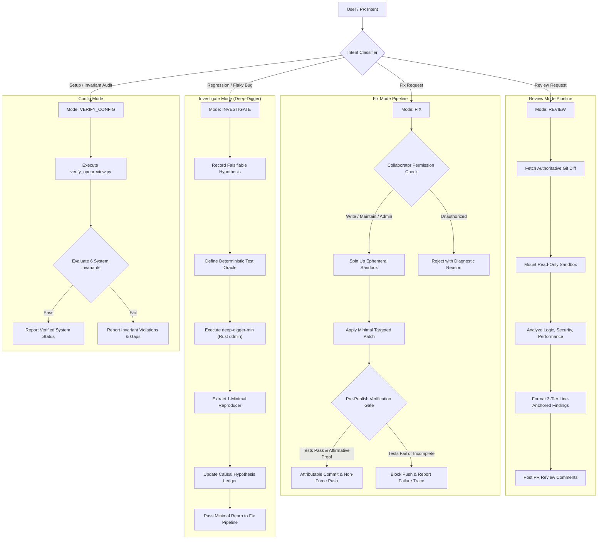

# OpenReview Orchestrator: Execution DAG

This reference details the Directed Acyclic Graph (DAG) for OpenReview tasks.

---

## State Transition Rules

1. **Review to Fix Escalation:**
   - A Review finding can transition to Fix mode only when an authorized collaborator replies with an explicit `@openreview fix` instruction.
   - Self-escalation by the agent without collaborator authorization is rejected.

2. **Fix to Investigate Fallback:**
   - If an automated fix fails the verification gate twice consecutively, the orchestrator triggers the **Circuit Breaker** and transitions to `INVESTIGATE` mode to isolate the root cause via `deep-digger-min` rather than continuing speculative edits.

3. **Termination Guarantees:**
   - Every branch of the DAG guarantees bounded execution:
     - Review: maximum 20 ReAct steps.
     - Fix: maximum 3 verification cycles before failing closed.
     - Investigate: maximum 200 oracle iterations (`max-tests`).
