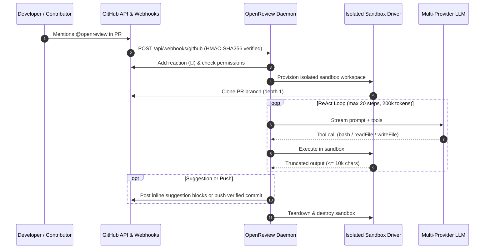

# OpenReview Agent Skill

[](LICENSE)
[](https://skills.sh)
[-green.svg)](scripts/verify_openreview.py)

> The definitive agentic standard for configuring, deploying, and verifying **OpenReview** — the autonomous GitHub PR review bot and on-demand coding assistant with pluggable sandbox execution (Local process & Docker OCI) and multi-provider LLM support (Anthropic Claude, OpenAI, Google Gemini, Ollama/vLLM).

---

## ⚡ Architecture & Execution Loop



---

## 🛡️ The 6 Non-Negotiable Invariants

| # | Invariant | Enforcement Mechanism |
|:--|:----------|:----------------------|
| **1** | **Constant-Time HMAC-SHA256 Webhook Verification** | `X-Hub-Signature-256` verified before JSON parsing; unauthenticated requests fail with HTTP 401. |
| **2** | **Absolute Credential Isolation** | RSA Private Keys and API tokens loaded exclusively via environment variables; `.env` must be in `.gitignore`. |
| **3** | **Enforced Sandbox Execution Boundaries** | Untrusted PR branch commands run inside ephemeral Docker OCI containers or bounded temp directories. |
| **4** | **ReAct Loop Fencing** | `max_steps <= 20`, `max_tokens <= 200,000`, `stdout_truncation <= 10,000` chars. |
| **5** | **Explicit GitHub App Permission Grants** | App requires `contents: write`, `pull_requests: write`, `issues: write`, `metadata: read`. |
| **6** | **GitHub Suggestion Block Formatting** | Code remediations emit valid ````suggestion```` markdown blocks anchored to line offsets. |

---

## 🚀 Quick Start

### 1. Installation

#### For AI Agents (Claude Code, Antigravity, Codex, Cursor):
```bash
npx skills add imMamdouhaboammar/openreview
# or
git clone https://github.com/imMamdouhaboammar/openreview.git ~/.agents/skills/openreview
```

#### Via Installer Script:
```bash
curl -fsSL https://raw.githubusercontent.com/imMamdouhaboammar/openreview/main/install.sh -o /tmp/install-openreview.sh
bash /tmp/install-openreview.sh
rm -f /tmp/install-openreview.sh
```

### 2. Auto-Generate Configuration
Run the deterministic configuration generator:
```bash
python3 scripts/generate_config.py
```
This inspects your project ecosystem (Rust, Go, Python, Node.js) and emits an optimized `openreview.config.json`.

### 3. Verify System Health & Invariants
Run the deterministic invariant audit tool:
```bash
python3 scripts/verify_openreview.py .
```

---

## 📂 Repository Structure

```
skills/openreview/
├── SKILL.md                          # Primary agent routing map & 5-step method
├── references/                       # Deep technical guides on demand
│   ├── invariants.md                 # Mathematical & security invariants
│   ├── config-schema.md              # JSON schema specification
│   ├── github-app-setup.md           # GitHub App registration & permissions
│   ├── sandbox-drivers.md            # Docker OCI vs Local isolation
│   ├── llm-providers.md              # Anthropic, OpenAI, Gemini, Ollama matrix
│   └── baseline-failure.md           # Empirical unguided failure analysis
├── scripts/
│   ├── verify_openreview.py          # Deterministic invariant verifier
│   └── generate_config.py            # Ecosystem-aware config generator
├── assets/
│   ├── openreview.config.template.json
│   ├── github-action-workflow.yml
│   └── docker-compose.openreview.yml
├── tests/
│   └── test_eval_suite.py            # Automated capability & regression evals
├── package.json                      # Universal distribution manifest
├── marketplace.json                  # Agent marketplace registry entry
├── .skills.json                      # Skills.sh contract descriptor
└── install.sh                        # Portable installer script
```

---

## 🧪 Evaluation & Test Results

The eval test suite (`tests/test_eval_suite.py`) enforces:
* **Capability Pass Rate**: 100% (Target: $\ge 90\%$)
* **Regression Pass Rate**: 100% (Target: $100\%$)
* **Security Scan Score**: 0 / 100 (`APPROVE`, zero unexplained findings)

To execute the test suite:
```bash
python3 -m unittest -v tests/test_eval_suite.py
```

---

## 📄 License

MIT © [Mamdouh Aboammar](https://github.com/imMamdouhaboammar)
